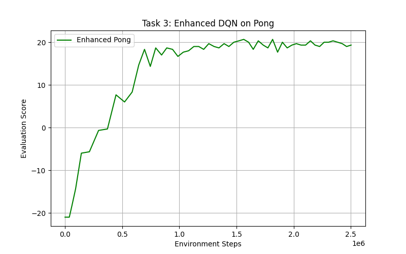
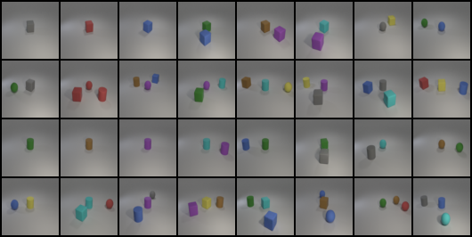

# NYCU Deep Learning & Deep Learning Labs (DLP)

My code, results, and reports for the labs of the Deep Learning course at National Yang Ming Chiao Tung University (NYCU), Spring 2026.

| Lab | Topic | Key result | Folder |
|---|---|---|---|
| 1 | Backpropagation, MLP in NumPy | 100% test accuracy on the linear and XOR datasets | [lab1-backpropagation](lab1-backpropagation) |
| 2 | Binary semantic segmentation (Oxford-IIIT Pet)  | Kaggle Dice 0.9341 (ResNet34-UNet), 0.9105 (UNet) | [lab2-segmentation](lab2-segmentation) |
| 3 | MaskGIT image inpainting  | Best FID 29.14 with the cosine mask schedule | [lab3-maskgit](lab3-maskgit) |
| 4 | Conditional VAE for video prediction  | Validation PSNR about 39.8 | [lab4-cvae-video](lab4-cvae-video) |
| 5 | DQN, Double DQN, PER, Dueling, multi-step (CartPole, Pong)  | Pong average reward 19.95 | [lab5-dqn](lab5-dqn) |
| 6 | Conditional diffusion on iCLEVR  | Classifier accuracy 0.8611 (test), 0.9048 (new test) | [lab6-diffusion](lab6-diffusion) |
| 7 | A2C and PPO (Pendulum, Walker2d)  | Walker2d average return up to 4240 | [lab7-a2c-ppo](lab7-a2c-ppo) |

Each lab folder has the same layout.

- `README.md` describes the task, the setup, the run commands, and the main results.
- `src/` holds the submitted code.
- `results/` holds plots, tables, and sample outputs.
- `report/` holds the report as PDF and LaTeX source.

## Academic integrity

Use this repository as a reference. Do not submit it as your own work. Your course probably prohibits plagiarism.

## License

The code is under the MIT License. The reports are shared for reading only.
