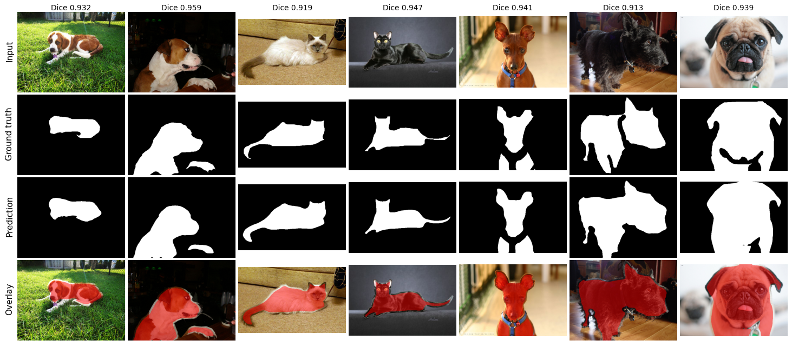
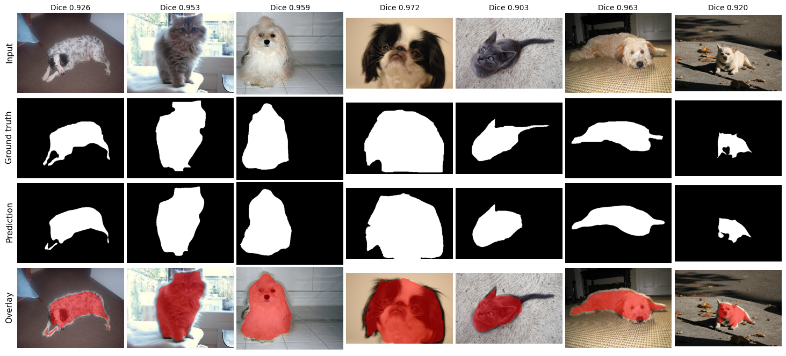

# Lab 2: Binary Semantic Segmentation



Foreground and background segmentation on the Oxford-IIIT Pet dataset with a UNet and a ResNet34-UNet. I built both models myself from PyTorch layers, with no ready-made model class such as `torchvision.models` and no pretrained weights. The metric is the Dice score from the Kaggle leaderboard.

## Setup

```bash
pip install -r requirements.txt
```

Download the Oxford-IIIT Pet dataset and put it in `dataset/oxford-iiit-pet/` next to the `split/` folder. The split files in `dataset/oxford-iiit-pet/split/` are included.

## Run

```bash
python src/train.py                              # UNet (default)
python src/train.py --model_type=resnet_unet     # ResNet34-UNet
python src/inference.py --ckpt_path <path to best.pth>
python src/inference.py --ckpt_path <path to best.pth> --model_type resnet_unet
python src/visualize.py --ckpt_path <path to best.pth> --model_type resnet_unet --out results/resnet_unet_samples.png
python src/visualize.py --ckpt_path <path to best.pth> --tile_pred true --out results/unet_samples.png
```

## Method

- Augmentation with Albumentations: RandomResizedCrop (ResNet34-UNet only), ShiftScaleRotate, ColorJitter, noise or blur, and CoarseDropout.
- Hybrid loss: 0.3 weighted cross-entropy and 0.7 Dice loss. The class weights are (3.0, 6.0, 1.0) for foreground, background, and border.
- AdamW with a 5-epoch linear warmup, then cosine annealing with warm restarts. Training runs for 315 epochs.
- Inference with multi-scale and horizontal-flip test-time augmentation. The UNet also uses tile prediction and a foreground threshold.
- The original UNet has no padding, so the output mask is smaller than the input (388x388 from 572x572). Training uses a center-cropped ground truth. Inference uses reflection padding and tiling to get a full-size mask.

## Results

### Qualitative Results

ResNet34-UNet:


UNet:



`src/visualize.py` creates these figures and prints the average Dice score.

### Quantitative Results

Dice score on the Kaggle leaderboard. The values come from the names of my submission files.

| Model | Change | Dice |
|---|---|---|
| UNet | Dice loss, warmup, cosine restarts | 0.8963 |
| UNet | + tile TTA | 0.9062 |
| UNet | + foreground threshold | 0.9065 |
| UNet | + circular padding | 0.9105 |
| ResNet34-UNet | Dice loss, warmup, cosine restarts | 0.9195 |
| ResNet34-UNet | Binary classes | 0.9201 |
| ResNet34-UNet | + more TTA | 0.9240 |
| ResNet34-UNet | + RandomResizedCrop, 150 epochs | 0.9252 |
| ResNet34-UNet | 320 epochs | 0.9290 |
| ResNet34-UNet | Corrected architecture | 0.9323 and 0.9341 (two runs) |
