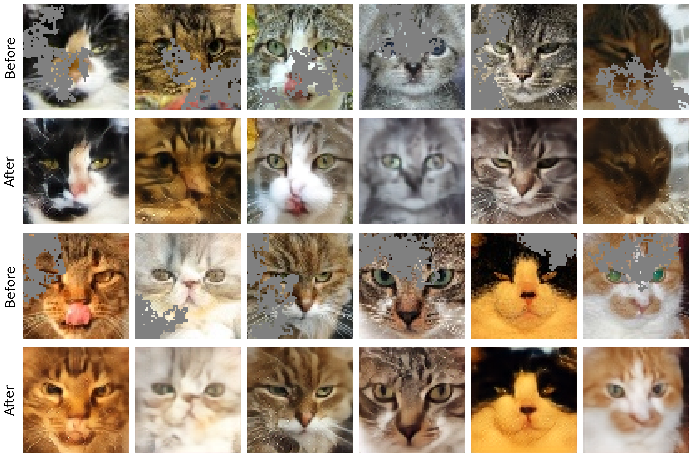
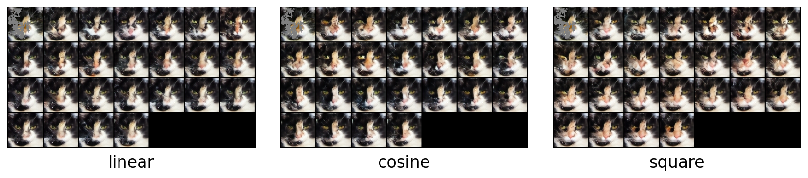
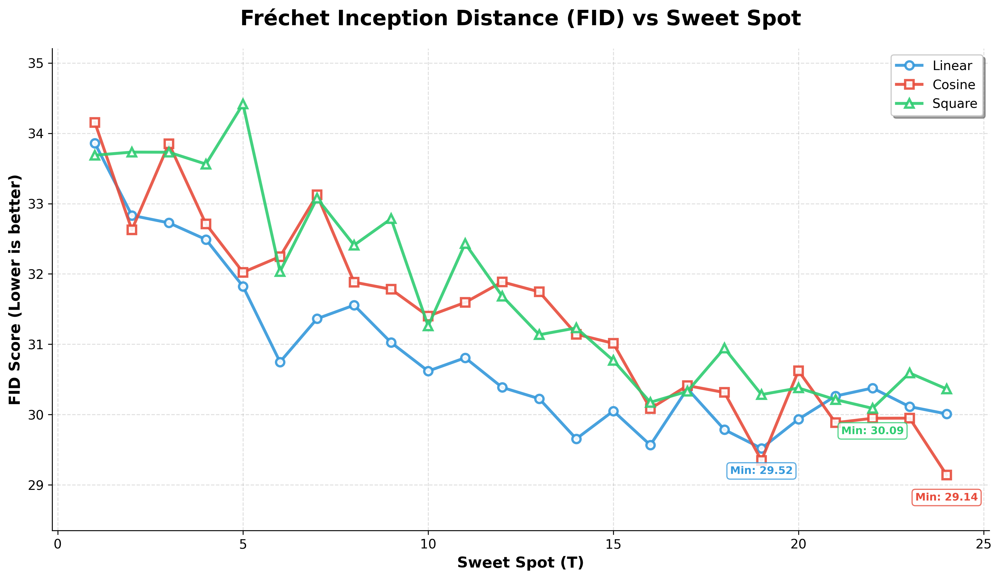

# Lab 3: MaskGIT for Image Inpainting

MaskGIT inpainting with a pre-trained VQGAN and a bidirectional transformer. Stage 1 is the VQGAN, which the course provides. Stage 2 trains the transformer to predict masked image tokens. Inpainting then fills the masked tokens in several iterative decoding steps. I implemented the multi-head attention of the transformer by hand, without calling `torch.nn.MultiheadAttention`.

## Setup

```bash
conda env create -f environment.yml
conda activate maskgit
```

You must add these files:

- The VQGAN checkpoint in `src/models/VQGAN/checkpoints/`.
- The LPIPS weights `vgg.pth` in `src/models/VQGAN/vgg_lpips/`.
- The dataset and the masks, in `src/lab3_dataset/`. You can change the paths with the command-line options.
- The `faster-pytorch-fid` tool in `src/faster-pytorch-fid/`, which computes the FID score.

## Run

Run the commands from inside `src/`, because the default paths are relative.

```bash
cd src
python training_transformer.py
python inpainting.py
```

## Code structure

```text
src/
├── training_transformer.py     # Stage 2: trains the transformer
├── inpainting.py               # Iterative decoding for inpainting
├── utils.py                    # Dataset classes for train, test, and mask images
├── config/MaskGit.yml          # MaskGIT and transformer settings
├── models/
│   ├── VQGAN_Transformer.py    # MaskGit class: tokens, masking, one decoding step
│   ├── Transformer/
│   │   ├── transformer.py      # Bidirectional transformer
│   │   └── modules/layers.py   # Multi-head attention, MLP, encoder layer, token predictor
│   └── VQGAN/                  # Stage 1: VQGAN from the course (encoder, decoder, codebook, LPIPS)
└── script/
    ├── find_sweet_spot.py      # Runs inpainting and FID to find the best decoding setting
    ├── plot_fid.py             # Plots the FID scores
    ├── create_comparison.py    # Compares masked and inpainted images
    └── combine_images.py       # Joins images into one figure
```

I wrote `training_transformer.py`, `inpainting.py`, `models/VQGAN_Transformer.py`, the multi-head attention in `models/Transformer/modules/layers.py`, and the scripts in `script/`. The rest is course starter code.

## Results

My best FID score is 29.1414. The cosine mask schedule gave the best results of the schedules that I compared. `results/func_comparison.png` plots the mask schedule functions.

Two choices improved the FID score:

- Sampling a token from the predicted distribution instead of `argmax`, as in the MaskGIT paper.
- Gradient accumulation over 10 steps. The GPU limited the batch size to 16, so the effective batch size was 160.

### Inpainting results

Each pair of rows shows the masked input (before) and the inpainted image (after). The grey areas are the masked regions.



### Iterative decoding

The model fills the masked tokens over 24 decoding steps. Each tile is the image after one step, from the masked input at the top left to the final result. The three grids use the linear, cosine, and square mask schedules.



### FID by mask schedule

FID (lower is better) when the output is the image from decoding step T, out of 24 steps in total. The code calls T the sweet spot. The cosine schedule reaches the lowest FID, 29.14 at T=24. The linear schedule reaches 29.52 and the square schedule reaches 30.09.



The full analysis is in [report/report.pdf](report/report.pdf).
