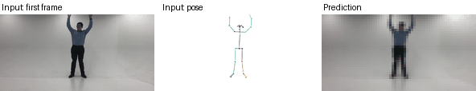
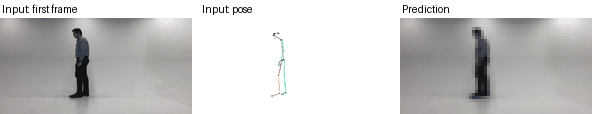
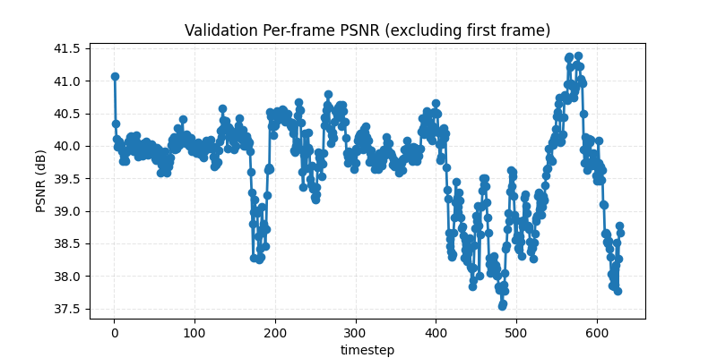
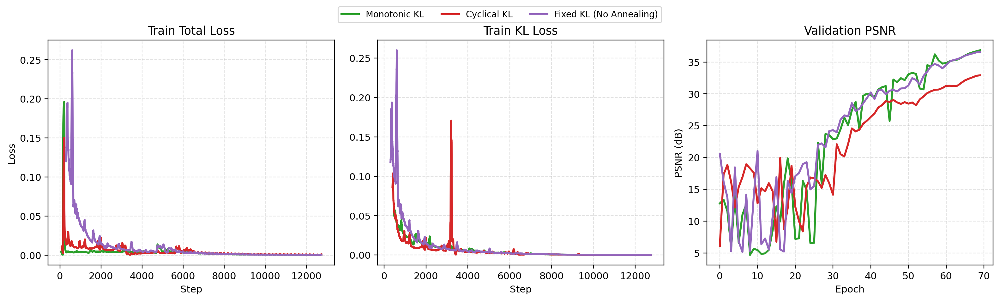

# Lab 4: Conditional VAE for Video Prediction

A conditional VAE that predicts the next video frames. The model trains with teacher forcing and KL annealing. At test time it averages several latent samples (Monte Carlo averaging) to reduce variance.

## Setup

```bash
pip install -r src/requirements.txt
```

You must add the course dataset. The default data path is `data`. Change it with `--DR`.

## Run

This command trains my best configuration.

```bash
python src/Trainer.py \
    --exp_name best --num_epoch 70 \
    --tfr 0.7 --tfr_sde 10 --tfr_d_step 0.05 \
    --kl_anneal_type mono \
    --train_shuffle --seed 3407 --train_vi_stride 8
```

`src/Tester.py` creates the test predictions and the GIFs. The `scripts/` folder has the sweeps for teacher forcing and KL annealing.

## Results

- The best setting uses shuffled training windows, a sliding-window stride of 8, monotonic KL annealing, and the teacher forcing schedule `tfr=0.7, tfr_sde=10, tfr_d_step=0.05`.
- Shuffling raised the validation PSNR from about 37.58 to 38.23. Shuffling and a sliding window together raised it to about 39.81.
- Teacher forcing once per epoch with `tfr=0.7` gave the best average PSNR (35.0). Teacher forcing once per frame gave 30.8 to 31.6.
- A decay step of 0.10 often failed to train.
- Monotonic KL annealing gave a higher final PSNR than cyclical annealing.
- Using 32 Monte Carlo samples instead of 1 gave a small PSNR gain.
- PSNR still drops in the later frames, so long-horizon drift remains the main limit.

`results/` holds the sweep summaries as CSV and Markdown, the KL schedule plot, and `gifs/` with two predicted sequences from the best run.

## Visualization

Predicted sequences from the best run. Each GIF shows the model input on the left (the first frame and the pose sequence) and the prediction on the right. The model sees the images at 64x32 pixels, so the prediction looks blocky. The pose is drawn at a higher resolution because the thin lines vanish at 64x32.

Sequence 0:



Sequence 1:



Validation PSNR of each predicted frame. PSNR varies between about 37.5 and 41.5 dB.



Training loss, KL loss, and validation PSNR for monotonic, cyclical, and fixed KL weights. Monotonic and fixed weights reach a higher PSNR than the cyclical weight in this run.



The full analysis is in [report/report.pdf](report/report.pdf).
