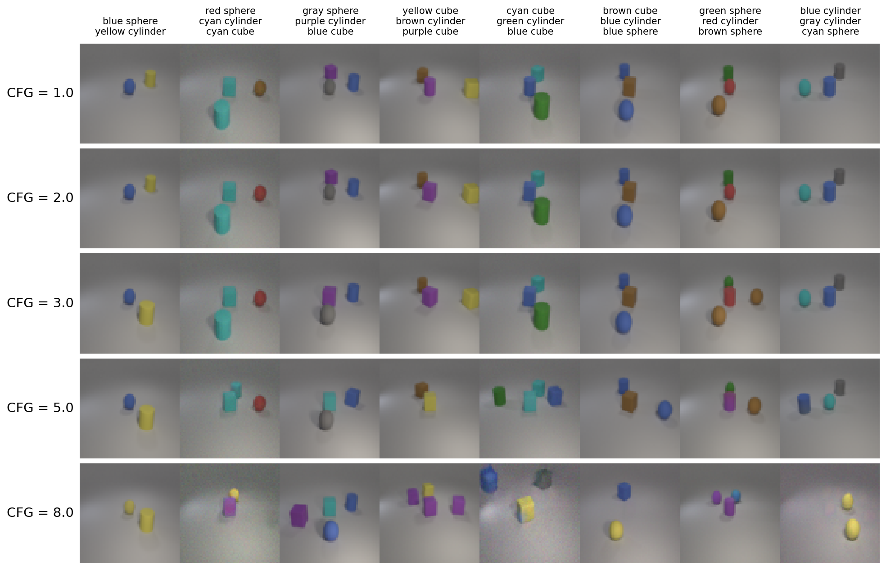
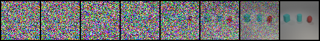

# Lab 6: Conditional Diffusion on iCLEVR

A conditional DDPM that generates 64x64 images from multi-label object descriptions, such as "red cube" and "blue sphere". The U-Net uses cross-attention for the labels. Classifier-free guidance (CFG) strengthens the conditioning, and DDIM gives faster sampling.

## Setup

```bash
pip install -r src/requirements.txt
```

You must add these files from the course to `src/`:

- `evaluator.py` and `checkpoint.pth`, the pre-trained classifier.
- `objects.json`, `train.json`, `test.json`, and `new_test.json`.
- The `iclevr/` image folder.

## Run

Run the commands from inside `src/`.

```bash
python main.py --cond_type cross_attn --exp-name train_cross_attn --epochs 200
python sample.py --ckpt-path <path to best.pth> --scheduler_type ddpm --num_test_timesteps 1000
```

The `scripts/` folder has the experiment commands. `plot_cfg_comparison.py` plots the effect of the CFG weight.

## Results

The best configuration uses cross-attention, CFG weight 3.0, the scaled-linear beta schedule, and DDPM with 1000 steps.

| Test set | Accuracy | Inference time |
|---|---|---|
| `test.json` | 0.8611 | 59.47 s |
| `new_test.json` | 0.9048 | 59.68 s |

- Cross-attention reached over 0.86 accuracy. Concatenating the labels reached about 0.43.
- DDIM with 10 steps takes about 2.5 s. It is much faster, but it is less accurate than DDPM with 1000 steps.
- A high CFG weight with few sampling steps hurts accuracy. For example, CFG 8.0 with 50 DDIM steps reached 0.33.

`results/eval_summary.md` lists every evaluation run. The test sets have only 32 images each and the sampling is random, so single runs differ by several points. Some runs score higher than the numbers above. The report uses the runs in the table above. `results/result.png` and `results/result_process.png` show generated images and the denoising process. ## Visualization

Generated images for the 32 labels in `test.json`.


The effect of the CFG weight. Each column uses one label, and each row uses one CFG weight. A weight of 8.0 gives wrong objects and strong artifacts.



The denoising process, from noise (left) to the final image (right).



The full analysis is in [report/report.pdf](report/report.pdf).
