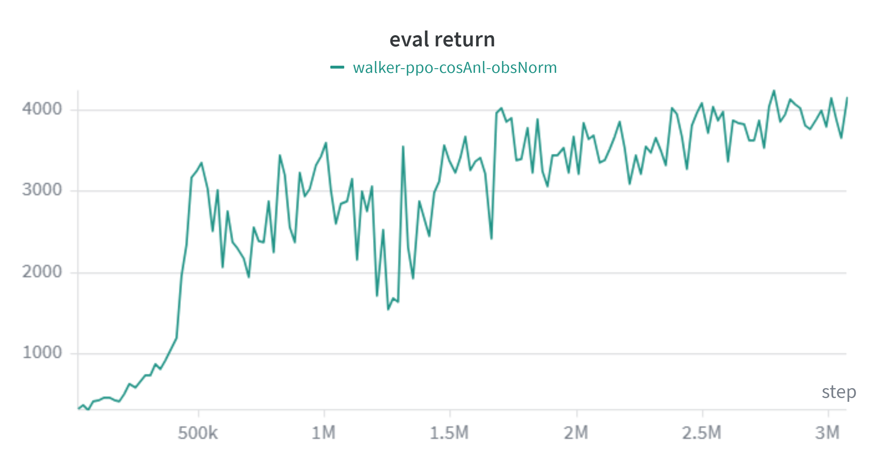
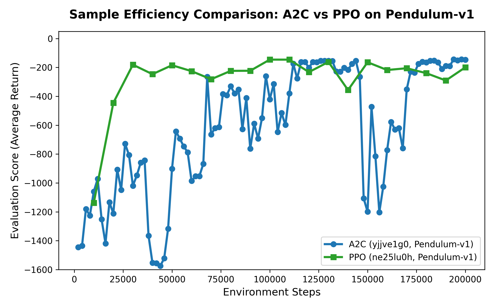
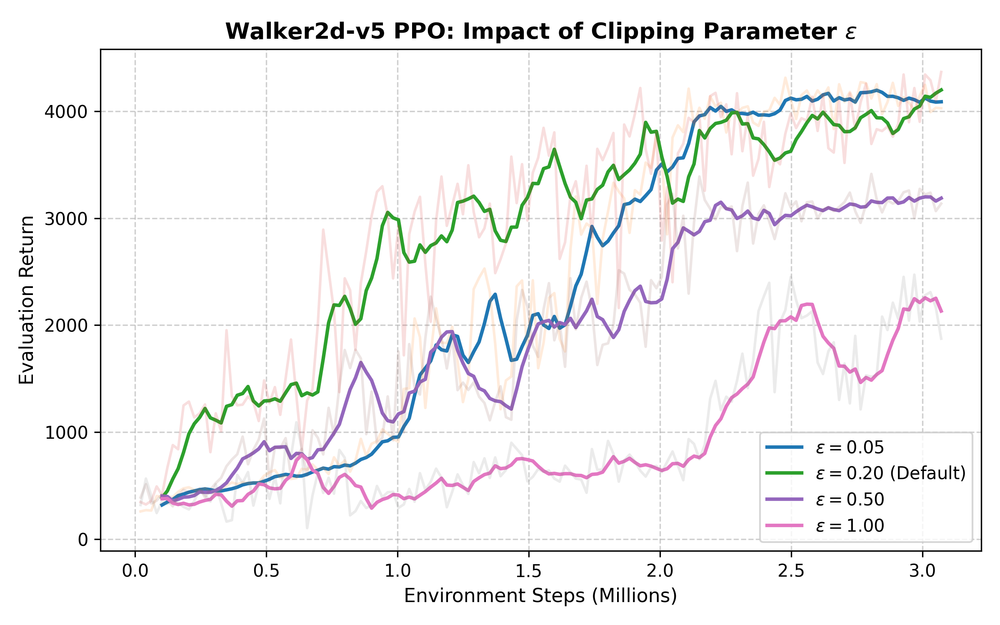

# Lab 7: A2C and PPO for Continuous Control



Advantage Actor-Critic (A2C) and Proximal Policy Optimization (PPO) on Pendulum-v1 and Walker2d-v5.

| Task | Environment | Agent | Script |
|---|---|---|---|
| 1 | Pendulum-v1 | A2C | `src/a2c_pendulum-2.py` |
| 2 | Pendulum-v1 | PPO | `src/ppo_pendulum-3.py` |
| 3 | Walker2d-v5 | PPO | `src/ppo_walker-3.py` |

## Setup

```bash
conda create -y -n dlp_lab7 python=3.11
conda activate dlp_lab7
pip install -r src/requirements.txt
```

## Train

```bash
python src/a2c_pendulum-2.py
python src/ppo_pendulum-3.py
python src/ppo_walker-3.py --obs-norm --adv-norm --sched
```

The Walker2d flags turn on observation normalization, advantage normalization, and a cosine learning rate schedule. `src/run_experiments.py` runs the clip range and entropy weight study on Walker2d.

## Test

You must train first, because the weights are not in this repository.

```bash
python src/test_model_task1.py task1_a2c_pendulum.pth
python src/test_model_task2.py task2_ppo_pendulum.pth
python src/test_model_task3.py .
```

## Results

- A2C on Pendulum-v1 reached -143.41 with the best checkpoint, saved at 19.8k steps.
- PPO on Pendulum-v1 reached -145.94 at 10k steps. Both pass the target of -150.
- PPO on Walker2d-v5 passed a return of 2500 within 1M steps.

Average return of PPO on Walker2d-v5, tested with 20 random seeds per checkpoint:

| 1M | 1.5M | 2M | 2.5M | 3M | Best |
|---|---|---|---|---|---|
| 3292 | 3431 | 3325 | 3921 | 3825 | 4240 |

Observation normalization matters most for Walker2d. Advantage normalization and the cosine learning rate schedule add further gains. `results/` holds the training curves of the clip range and entropy weight study as JSON files.

A2C and PPO on Pendulum-v1. PPO reaches a return near -200 within 30k steps, while A2C is slower and less stable.



The effect of the clip range on Walker2d-v5. The default value 0.2 learns fastest, and the value 1.0 learns slowest.



The full analysis is in [report/report.pdf](report/report.pdf).
